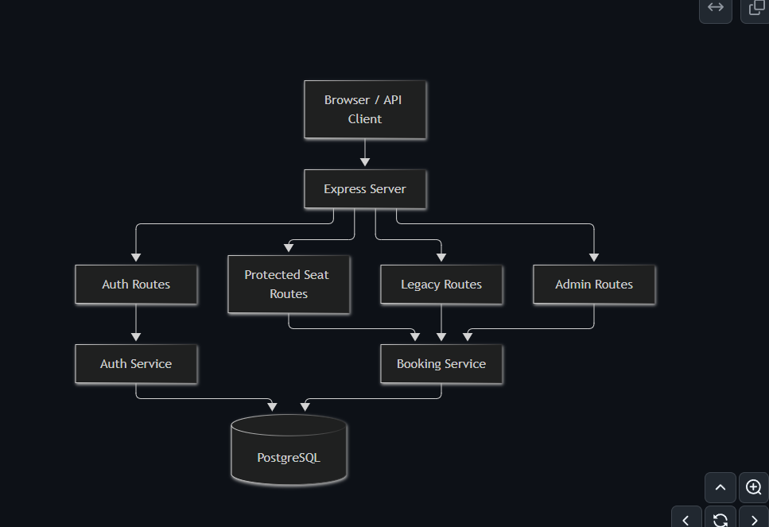
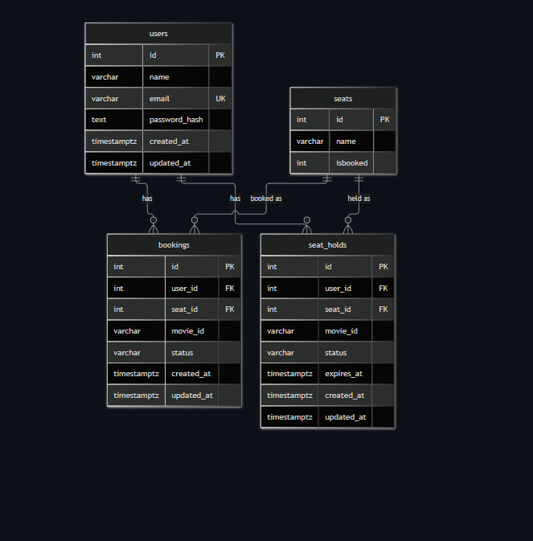
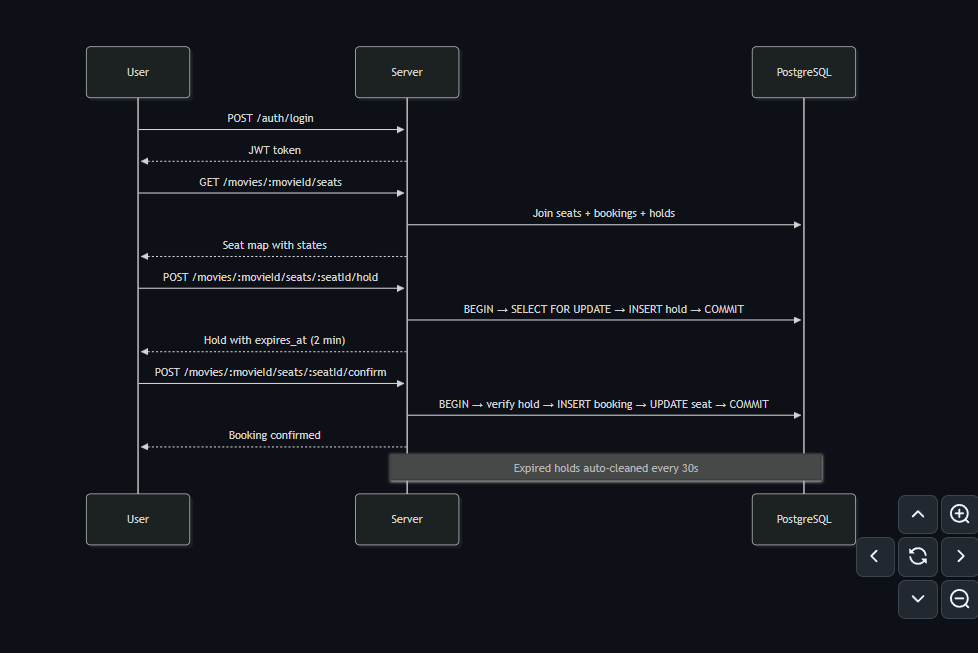

# 🎟️ Book My Ticket - Movie Ticket Booking Platform

[](https://nodejs.org/)
[](https://expressjs.com/)
[](https://supabase.com/)
[](https://www.mongodb.com/atlas)
[](https://tailwindcss.com/)

A production-grade, concurrency-safe movie ticket booking application developed for the **Chai Aur SQL Hackathon** based on the official starter codebase ([`chaicodehq/book-my-ticket`](https://github.com/chaicodehq/book-my-ticket)).

This platform enhances the starter architecture with **dual-database persistence (Hybrid Polyglot)**, enterprise-standard **JWT authentication** with email verification, strict **concurrency row-level locking (`SELECT ... FOR UPDATE`)**, and an elegant, responsive light-theme UI.

---

## 🏛️ System Architecture

The application adopts a clean, layered architecture separating routing, business services, database persistence, and shared validation/middleware:



### Key Architectural Layers:
- **Presentation / Client Layer**: Light, accessible single-page web interface (`public/index.html` & `public/app.js`) rendering live cinema seat matrices.
- **API Routing Layer**: Express 5 routing isolating authentication routes (`/api/auth/*`), protected seat booking routes (`/api/bookings/*`), and preserved starter routes (`/seats`, `/:id/:name`).
- **Middleware Pipeline**: Input validation using **Joi DTOs**, JWT authentication middleware (`auth.middleware.js`), and centralized error handling (`error.middleware.js`).
- **Hybrid Polyglot Storage**:
  - **MongoDB Atlas (Mongoose)**: Manages user profiles, role-based access, bcrypt credential hashing, refresh token rotation, and email verification tokens.
  - **PostgreSQL (Supabase)**: Handles transactional cinema seats and concurrency locking, ensuring ACID guarantees for seat reservation workflows.

---

## 📊 Database Schema & ER Diagram

The relational data model guarantees data integrity, foreign key cascades, and high concurrency efficiency:



### Tables & Relationships:
1. **`users`** (MongoDB Atlas / PostgreSQL Schema Model):
   - Stores user authentication state (`id`, `name`, `email`, `password_hash`, `is_verified`, `role`).
2. **`seats`** (PostgreSQL):
   - Stores cinema seat numbers, current booking state (`isbooked`: 0 or 1), and last updated timestamp.
3. **`bookings`** (PostgreSQL):
   - Connects authenticated users with reserved seats and target movies (`user_id`, `seat_id`, `movie_id`, `status`).
4. **`seat_holds`** (PostgreSQL Extended Pattern):
   - Enables temporary holds with expiration timers (`expires_at`) before final purchase confirmation.

---

## ⚡ Concurrency Control & Request Flow

To solve the double-booking problem when multiple users attempt to reserve the same seat simultaneously, the platform implements **Pessimistic Row-Level Locking** via PostgreSQL `SELECT ... FOR UPDATE` inside an isolated transaction:



### How Row-Level Locking Prevents Race Conditions:
```sql
-- 1. Begin atomic transaction
BEGIN;

-- 2. Lock the specific seat row against concurrent transactions
SELECT * FROM seats 
WHERE id = $1 AND isbooked = 0 
FOR UPDATE;

-- 3. If no row returned (seat already booked or held), rollback immediately
-- 4. Otherwise, safe to update the seat record
UPDATE seats 
SET isbooked = 1, name = $2, updated_at = NOW() 
WHERE id = $1 
RETURNING *;

-- 5. Commit transaction and release lock
COMMIT;
```

If Transaction A and Transaction B arrive at the exact same millisecond for Seat 5:
1. **Transaction A** acquires the exclusive row-level lock on Seat 5.
2. **Transaction B** is paused by PostgreSQL until Transaction A commits.
3. Upon commit, Transaction B reads `isbooked = 1` and receives an immediate **`409 Conflict: Seat already booked`**.
4. Zero duplicate bookings can ever occur.

---

## 📡 API Reference

### 1. Preserved Starter Endpoints
These endpoints maintain full backward-compatibility with the original starter repository:

| Method | Endpoint | Description |
|---|---|---|
| `GET` | `/` | Serves the web application frontend |
| `GET` | `/seats` | Returns all 20 cinema seats with their live booking state |
| `PUT` | `/:id/:name` | Legacy starter booking route with concurrency row-level lock |

### 2. Authentication Endpoints (`/api/auth`)
| Method | Endpoint | Auth | Description |
|---|---|---|---|
| `POST` | `/api/auth/register` | None | Register account (`name`, `email`, `password`) & triggers Mailtrap verification |
| `GET` | `/api/auth/verify-email/:token` | None | Verifies user email address |
| `POST` | `/api/auth/login` | None | Authenticates credentials and returns JWT `accessToken` & sets `refreshToken` |
| `POST` | `/api/auth/refresh-token` | None | Issues a new access token using httpOnly refresh cookie |
| `GET` | `/api/auth/me` | Bearer | Returns currently authenticated user profile |
| `POST` | `/api/auth/forgot-password` | None | Sends a 15-minute expiring password reset token |
| `PUT` | `/api/auth/reset-password/:token`| None | Resets password with valid token |
| `POST` | `/api/auth/logout` | Bearer | Invalidates refresh token and clears session |

### 3. Protected Booking Endpoints (`/api/bookings`)
| Method | Endpoint | Auth | Description |
|---|---|---|---|
| `POST` | `/api/bookings` | Bearer | Concurrency-safe seat booking (`{ "seatId": 5 }`) |

---

## 🎨 Frontend Light-Theme Showcase

The user interface is designed with a modern light palette using Tailwind CSS:
- **Live Seat Map**: Real-time 20-seat matrix with visual legend:
  - ⬜ **Available**: Clickable, hover feedback.
  - 🟦 **Selected**: Highlighted with indigo accent.
  - 🟥 **Booked**: Disabled with cross indicator.
- **Authentication Modal**: Tabbed Sign In and Register dialogs with client validation.
- **Booking Summary Drawer**: Displays selected seat number, ticket price, and dynamic call-to-action button based on authentication status.

---

## ⚙️ Environment Variables

Copy `env.example` to `.env`:
```bash
cp env.example .env
```

Configure your credentials:
```env
PORT=8080
NODE_ENV=development

# 1. MongoDB Atlas (Users & Auth)
MONGODB_URI=mongodb+srv://<username>:<password>@cluster0.xxxxx.mongodb.net/book_my_ticket?authSource=admin&retryWrites=true&w=majority

# 2. PostgreSQL (Supabase / Neon - Seat Concurrency)
DATABASE_URL=postgresql://<username>:<password>@db.xxxxx.supabase.co:5432/postgres

# 3. JWT Configuration
JWT_ACCESS_SECRET=your_super_secret_access_key
JWT_ACCESS_EXPIRES_IN=15m
JWT_REFRESH_SECRET=your_super_secret_refresh_key
JWT_REFRESH_EXPIRES_IN=7d

# 4. Mailtrap SMTP Configuration
SMTP_HOST=sandbox.smtp.mailtrap.io
SMTP_PORT=2525
SMTP_USER=your_mailtrap_user
SMTP_PASS=your_mailtrap_password
SMTP_FROM_NAME="BookMyTicket"
SMTP_FROM_EMAIL=noreply@bookmyticket.com

CLIENT_URL=http://localhost:8080
```

> **Note on Special Characters in Passwords**: If your database passwords contain special characters like `@`, they must be percent-encoded (e.g., `Pass@123` becomes `Pass%40123`).

---

## 🚀 Local Quickstart

```bash
# 1. Clone repository
git clone https://github.com/dev-ops-om/Book-My-Ticket--Movie-ticket-booking-system.git
cd Book-My-Ticket--Movie-ticket-booking-system

# 2. Install dependencies
npm install

# 3. Run development server
node server.js
```

The application will automatically connect to MongoDB Atlas and Supabase PostgreSQL, create the `seats` table if missing, seed 20 seats, and launch on:
👉 **`http://localhost:8080`**
